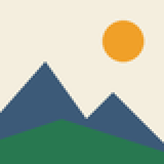

# image-to-svg

<!-- claude-arsenal:attribution: added by claude-arsenal's /init. Delete this block to drop it (it is not put back), or set `attribution = false` in the arsenal config.toml. -->
[](https://github.com/nuncaeslupus/claude-arsenal)
<!-- /claude-arsenal:attribution -->
[](https://github.com/nuncaeslupus/image-to-svg/actions/workflows/ci.yml)
[](https://github.com/nuncaeslupus/image-to-svg/actions/workflows/deploy.yml)

<p align="center">
  
</p>

**Convert raster images to SVG in the browser, free and without uploading anything.**

Raster-to-vector conversion is the feature most online converters put behind a
paywall or an upload. image-to-svg runs the [VTracer](https://github.com/visioncortex/vtracer)
engine as WebAssembly on your own device: no server, no upload limit, no account,
and it keeps working offline once loaded.

## Quick start

Open **<https://nuncaeslupus.github.io/image-to-svg/>** (Spanish:
[`/es/`](https://nuncaeslupus.github.io/image-to-svg/es/)), drop an image, and
download the SVG.

To run it locally:

```bash
git clone https://github.com/nuncaeslupus/image-to-svg.git
cd image-to-svg
npm install
npm run dev
```

## Example

An 80x80 PNG (shown enlarged) traced by the app's VTracer engine with the default
settings (Colors: Auto, Smoothness 50, Detail 50):

| Input: `before.png` (80x80 raster, 4 KB) | Output: `after.svg` (4 paths, 2.6 KB) |
|---|---|
|  |  |

The output is plain SVG with a `viewBox`, so it scales to any size:

```xml
<svg viewBox="0 0 80 80" version="1.1" xmlns="http://www.w3.org/2000/svg" width="80" height="80">
<path d="M0 0 C26.4 0 52.8 0 80 0 ..." fill="#F3EDDD" transform="translate(0,0)"/>
...
```

## Features

A wizard: **Upload, Edit, Trace, Export**.

- **Input:** PNG, JPEG, WebP, GIF, BMP and AVIF, up to a size limit.
- **Edit:** crop, rotate (90-degree steps or any angle), zoom.
- **Trace:** Colors (Black & white, a fixed count, or Auto), Smoothness, Detail
  and Contrast; transparent or solid background. Hold to compare with the original.
- **Export:** download or copy the SVG, set the output width and height, see the
  estimated file size and path count.
- **Fast tweaks:** tracing runs in a Web Worker on a downscaled preview;
  background and size changes edit the SVG without retracing.
  Export retraces once at full resolution.
- **Private and offline:** a static site on GitHub Pages, installable as a PWA.

## How it works

The tracer sits behind a `bitmap -> SVG` interface (`src/lib/traceProtocol.ts`).
The engine is VTracer compiled to WASM from `vtracer-wasm/` and shipped in
`src/wasm/`. The sliders are translated to VTracer's native options in
`src/lib/paramTranslation.ts`; a fixed color count is enforced by quantizing the
pixels before tracing (`src/lib/quantize.ts`).

## Limitations

- It traces the pixels it is given; it does not redraw. Blurry or noisy photos
  produce many small shapes.
- No CLI or API: everything happens in the browser UI.
- Open problems are listed in [`docs/known-issues.md`](docs/known-issues.md).

## Development

The Node.js version in `package.json` `engines`.

```bash
npm install
make ci          # lint, typecheck, unit tests, build test
npm run build    # production build into dist/
make hero        # redraw docs/hero.svg and docs/hero.png (needs Chromium + uv)
```

The repo uses the [claude-arsenal](https://github.com/nuncaeslupus/claude-arsenal)
spec, design and execution workflow (`claude-arsenal/`, skills in `.claude/skills/`).

## Related projects

- [claude-arsenal](https://github.com/nuncaeslupus/claude-arsenal) — spec-driven Claude Code workflow and gated task queue.
- [drawspec](https://github.com/nuncaeslupus/drawspec) — declarative diagram spec → clean SVG/PNG/text, writable by LLMs; MCP server included.
- [doc-control](https://github.com/nuncaeslupus/doc-control) — lets AI agents edit Word documents as tracked changes.
- [literary-critic](https://github.com/nuncaeslupus/literary-critic) — LLM manuscript analysis the way a professional editor would.
- [integral-job-search](https://github.com/nuncaeslupus/integral-job-search) — candidate-centred job search run in Claude Code.

## License

MIT — see [LICENSE](LICENSE).
